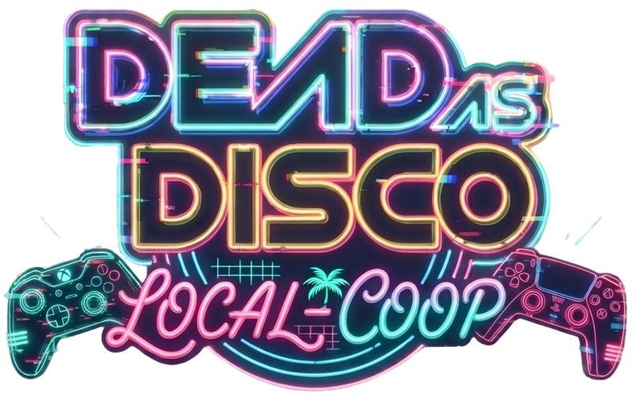

  

<h1 align="center">Dead as Disco — Local Co-op Mod (v1.0 Experimental)</h1>

  Play <strong>Dead as Disco</strong> together in 2-player local co-op! Team up across the Dive Bar and every stage with custom character (CSM) support, a co-op revive mechanic, independent Player 2 builds, native Player 2 HUD, and Split-Screen or Shared Arena camera modes.

---

## ✨ Features

### 🎮 2-Player Local Co-op
- **Instant Drop-In:** Connect Player 2 anytime in the Dive Bar or during a stage by holding **`L3 + R3`** on a controller or pressing **`F6`** on the keyboard.
- **Flexible Controller Setups:** Play with **1 Keyboard & Mouse (Player 1) + 1 Controller (Player 2)** by default, or switch to **2 Controllers** anytime in the settings menu.

### 🎭 Custom Character (CSM) & Wardrobe Support
- **Character Slot Mods (CSMs):** Automatically detects installed Character Slot Mods in your `~mods` folder so Player 2 can play as custom modded characters.
- **Full Charlie Wardrobe:** Mix and match individual Jackets, Hair, Glasses, Drumsticks, and Body Types for Player 2, or pick from 14 full Outfit Presets.

### ❤️ Co-op Revive System
- **Downed State & Revive Ring:** Taking fatal damage while your teammate is still alive puts you into a downed state on the ground with a glowing revive ring around you instead of ending the song.
- **Team Recovery:** Stand inside the ring to revive your partner (or hold **`X` / `A`** on controller / **`E` / `F`** on keyboard to revive faster). Revived players jump back up with a celebratory disco dance, restored health, and brief invulnerability.
- **Team Wipe:** Game Over only triggers if both players are downed at the same time.

### ⚡ Independent Player 2 Builds & Saved Profile
- **Separate Skills & Loadouts:** Equip Player 2 with their own 4 Boss Abilities, Idol Skill Tree Upgrades across all 6 Idols (Charlie, Dahlia, Arora, Prophet, Rebel, and Shred), and 4 D-Pad Dance Moves.
- **Automatic Saving:** Player 2's chosen character, outfit, skills, dances, and camera preferences save automatically between sessions.

### 🖥️ Native Player 2 HUD & Screen Modes
- **Full Player 2 Interface:** Displays Player 2's Hearts, Execution Tokens, Fever Bar, Combo Multiplier, and Boss Ability slots.
- **3 Camera & Screen Modes (`F9`):**
  - **Horizontal Split-Screen:** Top and bottom viewports with independent cameras.
  - **Vertical Split-Screen:** Left and right viewports (great for ultrawide displays).
  - **Shared Arena Camera:** Single shared screen for combat with `PLAYER 1` and `PLAYER 2` HUD tags and colored floor circles (**Cyan** for P1, **Pink** for P2).

### 🛠️ In-Game Player 2 Menu (Dive Bar & Mid-Match)
- **Full Dive Bar Studio:** Press **`Select / View`** on Player 2's controller (or **`F2`**) in the Dive Bar to browse all 5 tabs (`CHARACTER`, `MOVES`, `DANCES`, `UPGRADES`, `SETTINGS`) with 360° Right-Stick character rotation.
- **Mid-Match Pause Menu:** Opening the Player 2 Menu during a song pauses both the game and the music track so Player 2 can swap character models, attacks, or camera settings mid-run.

### 🧪 Experimental Features (Optional Toggle)
Enable **Experimental Features** inside **P2 Menu → Settings** to unlock bonus options:
- **6 Neon Rim Tints** for Player 2 (`Neon Cyan`, `Disco Magenta`, `Electric Gold`, `Crimson Flame`, `Emerald Mint`, `Royal Violet`).
- **15 Playable Boss & Enemy Models** for Player 2 (including *La Pantera*, *Arora*, *Rebel*, *Shred*, *Bouncer*, *Mosher*, *Fanatic*, *Echo*, *Stix*, and more).
- **Dynamic Arena Midpoint Camera & Auto-Leash** options.

---

## 🕹️ Controls

| Action | Gamepad | Keyboard |
| :--- | :--- | :--- |
| **Connect Player 2** | Hold `L3 + R3` | `F6` |
| **Open / Close P2 Menu** | P2 `Select / View` | `F2` |
| **Cycle Screen / Camera Mode** | P2 Menu → `Settings` | `F9` |
| **Revive Downed Teammate** | Stand in ring *(hold `X` / `A` to speed up)* | Stand in ring *(hold `E` / `F` to speed up)* |
| **Pause & Game Menus** | `Start`, `D-Pad / Stick`, `A`, `B` | `Esc`, Mouse Cursor & Keyboard |

---

## 📦 Installation

1. Install **[RE-UE4SS](https://github.com/UE4SS-RE/RE-UE4SS)** (`v3.0.1 Beta` or newer for Unreal Engine 5.7) into `Dead as Disco\Pagoda\Binaries\Win64\`.
   *(For a one-step download that already includes UE4SS, grab the All-in-One package on [Nexus Mods](https://www.nexusmods.com/deadasdisco/mods/1567).)*
2. Download **`Dead_as_Disco_Local_Coop_v1.0_Experimental.zip`** from **[Releases](../../releases)**.
3. Extract the zip directly into your **Dead as Disco** game folder (where the `Pagoda` folder is located).
4. Launch the game, enter the **Dive Bar**, and hold **`L3 + R3`** (or press **`F6`**) to connect Player 2!

---

## 📁 Repository Layout

- `Pagoda/Binaries/Win64/ue4ss/Mods/LocalCoopMod/` — Mod source files (`Scripts/`), `enabled.txt`, and `README.md`
- `assets/` — Header logo (`header_logo.png`)
- `legacy/v2.2/` — Archived legacy `v2.2` version of the mod

---

## 🙏 Credits

- **[HyruleChosenOne](https://github.com/HyruleChosenOne) / [HyliaChosenOne](https://www.nexusmods.com/deadasdisco/mods/1567)** — Mod Creator & Maintainer
- **[RE-UE4SS Team](https://github.com/UE4SS-RE/RE-UE4SS)** — Unreal Engine Scripting System
- **Brain Jar Games, Inc.** — Creators and developers of *Dead as Disco*
- **Dead as Disco Modding & CSM Community** — Character Slot Mod creators, templates, and testers
- **Antigravity AI** — Co-development & UI/gameplay scripting
