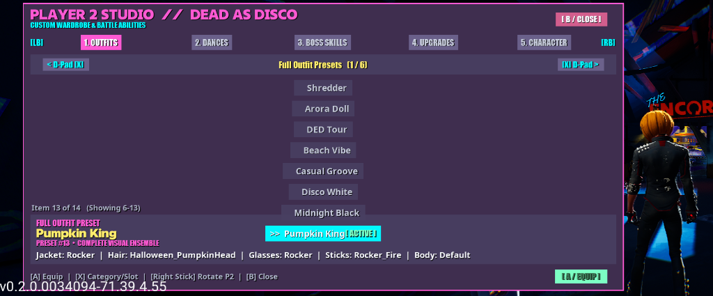

# Dead as Disco - Local Co-op Mod (v2.2)

<p align="center">
  
</p>

Bring a friend into the rhythm arena! This UE4SS mod adds full 2-player local co-op support to **Dead as Disco** with gamepad drop-in shortcuts, an **interactive 5-tab Custom UI Studio Menu** docked inside Player 2's viewport, 360° character preview rotation, Dive Bar Wardrobe & Skill Station support for Player 2, singleton duplicate-spawn protection, automatic fullscreen cinematic switching, per-viewport UI scaling, and deadlock-free pause menu routing.

---

## 📸 In-Game Screenshots

### Player 2 Custom Studio Menu (Docked Left Viewport)


---

## 🎮 Quick Start & Controls

Once inside the **Dive Bar** or any **Stage / Arena**:

### Gamepad Shortcuts (Player 2 Controller)
| Action | Controller Input | Description |
| :--- | :--- | :--- |
| **Connect / Regroup Player 2** | **`L3 + R3`** *(Stick Clicks)* | Connects Player 2 directly from a controller (or regroups P2 beside P1 if already active). |
| **Open P2 Studio Menu** | **`Select / View`** *(Back Button)* | Opens/closes **Player 2's Interactive 5-Tab Studio Menu** docked on the left of P2's viewport. |
| **Rotate Player 2 in Menu** | **Right Thumbstick (Left / Right)** | Rotates Player 2 360° in place so you can preview outfits, jackets, and hair from every angle! |
| **Dive Bar Station Interact** | **`X / A / Y`** *(Near Station)* | Walking up to the Dive Bar Wardrobe or Skill Tree as P2 opens P2's Custom Menu on Outfits or Skills! |
| **Pause / Resume Game (P2)** | **`Start / Menu`** | Opens and closes the Pause Menu safely from Player 2's controller without focus soft-locks. |
| **Quick-Cycle P2 Outfit** | **`Select + L3`** | Quick-cycles full outfit presets without opening the menu. |
| **Quick-Cycle P2 Loadout** | **`Select + R3`** | Quick-cycles skill & dance loadouts without opening the menu. |

### Navigating Player 2's Custom Studio Menu
- **`LB / RB`** *(or `PageUp / PageDown` / Mouse Click)*: Switch Tabs (**1. Outfits**, **2. Dances**, **3. Boss Skills**, **4. Upgrades**, **5. Character**)
- **`D-Pad Left / Right`** *(or `Left / Right` Arrows / `< >` Buttons)*: Switch Category, Idol Tree, or Target Slot (`1..4`)
- **`D-Pad Up / Down` / `Left Stick`** *(or `Up / Down` Arrows / Mouse Hover)*: Browse items with live localized descriptions
- **`Right Stick Left / Right`** *(or `[` / `]` Keys)*: Rotate Player 2 360° to inspect your character live in the viewport
- **`A / Cross`** *(or `Enter` / Mouse Click)*: Equip / Toggle selected Skin, Dance, Boss Ability, Upgrade, or Character Model live
- **`B / Circle` or `Select`** *(or `Backspace` / `[ B / CLOSE ]`)*: Close Player 2's Menu and resume P2 movement

### Keyboard Hotkeys
| Action | Primary Key | Alternate Key | Description |
| :--- | :--- | :--- | :--- |
| **Open P2 Outfits Menu** | `F2` | `Ctrl + [` | Opens/toggles Player 2's Custom Menu on **1. Outfits** (Presets, Jackets, Hair, Glasses, Sticks, Body). |
| **Open P2 Skills Menu** | `F3` | `Ctrl + ]` | Opens/toggles Player 2's Custom Menu on **3. Boss Skills** (Ability Slots, Upgrades, Dances). |
| **Quick-Cycle P2 Outfit** | `Shift + F2` | — | Cycles Player 2 through curated full-body outfit presets. |
| **Quick-Cycle P2 Loadout** | `Shift + F3` | — | Cycles Player 2 through curated Skill & Dance loadouts. |
| **Swap P2 Character Model** | `F4` | `Ctrl + \` | Swaps Player 2 live between **Charlie** and **Chuckles**. |
| **Cycle P2 Visual Tint Mode** | `Shift + F4` | — | Cycles between **AccentOnly**, **FullBody**, and **Off**. |
| **Toggle Controller Setup** | `F5` | — | Switches between **1 Keyboard/Mouse + 1 Controller** and **2 Controllers**. |
| **Spawn / Regroup Player 2** | `F6` | `Ctrl + Y` | Spawns Player 2 (strictly limited to 1 active P2 instance; regroups P2 if already active). |
| **Remove Player 2** | `F7` | `Ctrl + U` | Cleanly removes Player 2 and returns to single-player. |
| **Teleport P2 to P1** | `F8` | `Ctrl + I` | Teleports Player 2 right next to Player 1 if separated. |
| **Cycle Screen Mode** | `F9` | `Ctrl + P` | Cycles between **Horizontal Split**, **Vertical Split**, and **Shared Screen**. |
| **Toggle Auto-Leash** | `F11` | — | Toggles safety tethering in Shared Screen mode to keep P2 in frame. |

---

## 🕹️ Controller Setups Supported

### Setup A: 1 Keyboard/Mouse + 1 Gamepad (Default)
- **Player 1**: Keyboard & Mouse
- **Player 2**: Controller 1 (Xbox / PlayStation / Steam Deck / Generic)
- *If Gamepad 1 controls Player 1 instead, press `F5` to swap routing.*

### Setup B: 2 Gamepads
- **Player 1**: Controller 1
- **Player 2**: Controller 2
- *Press `F5` to set routing to 2 Controllers.*

---

## 🖥️ Screen Modes

Press `F9` (or `Ctrl + P`) at any time to switch modes on the fly:
1. **Horizontal Split-Screen (Default)**: Top and Bottom halves. Each player gets their own camera.
2. **Vertical Split-Screen**: Left and Right halves. Great for ultra-wide monitors.
3. **Shared Single-Screen (Arena Mode)**: Both players fight on one unified fullscreen camera view! With **Auto-Leash** enabled (`F11`), if Player 2 gets knocked far off the platform or arena, they are automatically tethered back near Player 1.

---

## ✨ Key Features

1. **Left-Docked Dead as Disco Studio (`Scripts/p2_menu.lua`)**
   - Docked on the left side of Player 2's viewport (`X: 0.02..0.44` in Horizontal Split, `X: 0.02..0.40` in Shared Screen) so Player 2 remains completely visible on the right while previewing outfits and moves!
   - Built with the game's bold signature neon palette (Electric Pink `#FF149E`, Cyber Cyan `#00F0FF`, Acid Gold `#FFDC1E`, Emerald `#26FF73`, Dark Obsidian `#090714`) and native typography (`Primary_Font`, `Secondary_Font`, `BodyText_Font`).
   - Driven directly by Player 2's controller (`PlayerInput` polling + Mouse/Keyboard support) so Player 1 can keep playing freely while Player 2 customizes.
   - Mix and match individual **Jackets**, **Hair**, **Glasses**, **Drumsticks**, and **Body Types**, assign any of the **22 Dance Moves** to 4 D-Pad slots, slot any of the **6 Idol Boss Abilities** into 4 ability slots, toggle individual **Skill Tree Upgrades** across all 6 Idols, and swap between **Charlie** and **Chuckles** + **6 Neon Shader Palettes**.
   - Walking up to the Dive Bar Wardrobe (`BP_DiveBar_Interact_Cosmetics_C`) or Skill Tree (`BP_DiveBar_Interact_SkillTree_C`) as Player 2 opens P2's Custom Menu directly on the matching tab.
2. **Crash-Free Non-Blocking Cosmetic Streaming**
   - Eliminates synchronous `FlushAsyncLoading` engine stalls and `0xC0000005` access violations during rapid preset cycling or character swaps.
   - Added bidirectional catalog aliases (`doll` ↔ `arora`, `beachsummerheadset` ↔ `summerheadset`, `summerhat` ↔ `beachsummerhat`, `halloweenpumpkinhead` ↔ `pumpkinhead`) and fallback to default cosmetics so corrupted or missing preset identifiers will never cause a crash.
   - Added character swap safety guards preventing `ClientRestart` from destroying the menu during character swaps.
3. **Strict Singleton Player 2 Enforcement**
   - Tracks `AActor.bActorIsBeingDestroyed`, pointer-level `UObject` identity (`SameUObject`), action debouncing, and orphan `PagodaPlayerCharacter` cleanup so duplicate/unusable copies of Player 2 can never spawn.
4. **Automatic Cutscene / Cinematic Viewport Switching**
   - Automatically switches from Split-Screen to **Fullscreen** during level sequences and video cutscenes, restoring your previous Split-Screen layout when finished.
5. **Deadlock-Free Pause Menu & Per-Player Viewport UI Scaling**
   - Routes Pause Menu ownership safely through the primary Slate viewport (`User 0`) and dynamically applies `ScaleToFit` DPI scaling + per-stack render scaling for clean split-screen HUDs and menus.

---

## 📦 Installation

1. Download `Dead_as_Disco_Local_Coop_Mod_v2.2.zip` from Releases.
2. Extract the contents directly into your Dead as Disco game root directory (where `Pagoda` folder is located, e.g. `steamapps\common\Dead as Disco\`).
3. Ensure `Pagoda\Binaries\Win64\ue4ss\Mods\mods.txt` contains:
   ```
   LocalCoopMod : 1
   ```
4. Launch the game and press `L3 + R3` on Player 2's controller or `F6` to start co-op!

---

## ⚙️ Configuration

All settings, gamepad bindings, tint palettes, UI scaling factors, and custom Player 2 presets can be edited in:
`Pagoda\Binaries\Win64\ue4ss\Mods\LocalCoopMod\Scripts\config.lua`

## Credits & Acknowledgements

- **[HyruleChosenOne](https://github.com/HyruleChosenOne)** — Mod Creator, lead logic design, and project maintainer.
- **[UE4SS Team](https://github.com/UE4SS-RE/RE-UE4SS)** — Unreal Engine 4/5 Scripting System & C++ modding framework powering all runtime hooks, UMG reflection, and memory manipulation.
- **Dangerous Bob Studios** — Creators and developers of **Dead as Disco** for crafting such an incredible rhythmic beat-'em-up experience.
- **Antigravity AI (Google DeepMind)** — Pair programming, architectural refactoring, custom UMG layout design, and async streaming crash diagnostics.
- **Community & Testers** — Thanks to everyone who tested early builds and provided feedback on split-screen viewport alignments and controller bindings!
